# dsh-swarm 包布局与发布顺序

> 配套：[`implementation-spec.md`](./implementation-spec.md)（阶段 0/1）、[`implementation-spec-stage2.md`](./implementation-spec-stage2.md)（阶段 2）、[`implementation-spec-stage3.md`](./implementation-spec-stage3.md)（阶段 3）
> 产出人：migration-architect ｜ 任务：P3-spec（0/1）→ P6-spec-stage2（2）→ **P10-spec-stage3（3 更新）**
> 约定：`【事实】`= 来自 DSH 0.2.1-rc.3 / example-plugin / 手册 / 已实现 19 包；`【推断】`= 未实测的方向判断；`【设计主张】`= 规格建议。

---

## 1. 包名 / 路径 / 阶段

| 包名 | 路径 | cordis 插件名（row id） | 服务键 | 形态 | 阶段 |
|---|---|---|---|---|---|
| `@elinpf/dsh-swarm-example-plugin` | `packages/example-plugin/` | `example-plugin` | — | 函数式 | 已有（基线） |
| `@elinpf/dsh-swarm-team-core-contract` | `packages/team-core-contract/` | （纯类型，无 row） | — | 纯类型 | 0 |
| `@elinpf/dsh-swarm-team-core` | `packages/team-core/` | `team-core` | `ctx.teamCore` | Service | 0 |
| `@elinpf/dsh-swarm-bundle` | `packages/bundle/` | （bundle，无 row） | — | bundle patch | 0 |
| `@elinpf/dsh-swarm-team-bus` | `packages/team-bus/` | `team-bus` | `ctx.teamBus` | Service | 1 |
| `@elinpf/dsh-swarm-team-scheduler` | `packages/team-scheduler/` | `team-scheduler` | `ctx.teamScheduler` | Service | 1 |
| `@elinpf/dsh-swarm-team-review` | `packages/team-review/` | `team-review` | `ctx.teamReview` | Service | 1 |
| `@elinpf/dsh-swarm-team-completion` | `packages/team-completion/` | `team-completion` | `ctx.teamCompletion` | Service | 1 |
| `@elinpf/dsh-swarm-team-prompt` | `packages/team-prompt/` | `team-prompt` | （用 `ctx.systemPrompt`） | 函数式 | 1 |
| `@elinpf/dsh-swarm-tool-swarm` | `packages/tool-swarm/` | `tool-swarm` | （用 `ctx.tools`） | 函数式 | 1 |
| `@elinpf/dsh-swarm-team-capability-contract` | `packages/team-capability-contract/` | （纯类型，无 row） | — | 纯类型 | 2 |
| `@elinpf/dsh-swarm-team-workspace` | `packages/team-workspace/` | `team-workspace` | `ctx.teamWorkspace` | Service | 2 |
| `@elinpf/dsh-swarm-team-skills` | `packages/team-skills/` | `team-skills` | `ctx.teamSkills` | Service | 2 |
| `@elinpf/dsh-swarm-team-memory` | `packages/team-memory/` | `team-memory` | `ctx.teamMemory` | Service | 2 |
| `@elinpf/dsh-swarm-team-compaction` | `packages/team-compaction/` | `team-compaction` | `ctx.teamCompaction` | Service | 2 |
| **`@elinpf/dsh-swarm-team-scale-contract`** | `packages/team-scale-contract/` | （纯类型，无 row） | — | 纯类型 | **3** |
| **`@elinpf/dsh-swarm-team-transport`** | `packages/team-transport/` | `team-transport` | `ctx.teamTransport` | Service | **3** |
| **`@elinpf/dsh-swarm-team-distributed`** | `packages/team-distributed/` | `team-distributed` | `ctx.teamDistributed` | Service | **3** |
| **`@elinpf/dsh-swarm-team-human`** | `packages/team-human/` | `team-human` | `ctx.teamHuman` | Service | **3** |
| **`@elinpf/dsh-swarm-team-durable`** | `packages/team-durable/` | （纯函数库，无 row） | — | 纯函数库 | **3（ADR-0002）** |

> **包数：9（阶段 0/1）→ 14（阶段 2）→ 18（阶段 3）→ 19（+ ADR-0002 `team-durable`）**。三个契约包均为**纯类型 SSOT**（零运行时实现）；`team-durable` 为**纯函数库**（无 cordis row，供各包 fold durable 事件）。
> **【事实·ADR-0001】** `team-core-contract` 是 `ctx.teamCore` 的唯一类型 SSOT；业务包**禁止** import 实现包，只从契约包取类型。
> **【设计主张·阶段 2 §1.1 / 阶段 3 §1.1】** 每个阶段（cohort）新增**独立契约包**（阶段 2 = `team-capability-contract`，阶段 3 = `team-scale-contract`），**不塞进前序契约包**：不同层（协作内核 / 能力供给 / 规模化边界）、不同冻结时点；独立成包同样满足 ADR-0001 的编译期边界。

**【设计主张】命名规则**：项目名 `dsh-swarm`；scope 一律 **`@elinpf/dsh-swarm-*`**（阶段 2 已迁移）；bundle 固定 `@elinpf/dsh-swarm-bundle`。插件名与 row id 同名。

**不在本布局实现**：`host-bridge` / `channels` / Web UI 单独成包（阶段 3 只提供 `team-human` 桥接面）；宿主（JiuwenSwarm）provider 注册表开放化属**跨仓交办**（非本 TS 仓）。

---

## 2. 依赖图

```mermaid
flowchart TB
  subgraph DSH["DSH 0.2.1-rc.3 提供的服务（外部 peer）"]
    TOOLS[ctx.tools]
    SP[ctx.systemPrompt]
    AG[ctx.agents]
    SESS[ctx.sessions]
    SUB["ctx.subagents（in/out-of-process providers）"]
    ATS["ctx.agentTeams（实验）"]
    FS["ctx.fs + fs/write-intent"]
    WD[ctx.workingDirectory]
    WT["ctx.worktrees（实验）"]
    SK[ctx.skills]
    ST[ctx.storage]
    CMP[ctx.compaction]
    SSHC["ctx.ssh（SSH-RPC，非重连）"]
    SPC[ctx.subprocess]
    UQ[ctx.userQuestions]
    JOBS[ctx.jobs]
  end
  subgraph CONTRACTS["契约包（纯类型 SSOT）"]
    CC1["team-core-contract<br/>ctx.teamCore"]
    CC2["team-capability-contract<br/>ctx.teamWorkspace/teamSkills/teamMemory/teamCompaction"]
    CC3["team-scale-contract<br/>ctx.teamTransport/teamDistributed/teamHuman"]
  end
  subgraph STAGE1["阶段 1 协作内核"]
    CORE["team-core"]; BUS["team-bus"]; SCH["team-scheduler"]
    REV["team-review"]; COMP["team-completion"]; PROMPT["team-prompt"]; TOOL["tool-swarm"]
  end
  subgraph STAGE2["阶段 2 能力供给"]
    WS["team-workspace"]; SKL["team-skills"]; MEM["team-memory"]; CMPC["team-compaction"]
  end
  subgraph STAGE3["阶段 3 规模化与边界"]
    TR["team-transport"]; DIS["team-distributed"]; HUM["team-human"]
  end
  NAT["DSH 原生 agent-team / tool-agent-team（复用行）"]
  BUNDLE["@elinpf/dsh-swarm-bundle（cordis.patch.yml）"]

  NAT --> ATS
  CORE --> ATS
  BUS --> CORE
  SCH --> CORE
  SCH --> BUS
  REV --> CORE
  COMP --> CORE
  PROMPT --> SP
  PROMPT --> CORE
  TOOL --> BUS
  TOOL --> CORE

  WS --> FS
  WS --> WT
  WS --> CORE
  SKL --> SK
  SKL --> CORE
  MEM --> SP
  MEM --> ST
  MEM --> CORE
  CMPC --> CMP
  CMPC --> CORE

  TR --> SPC
  TR --> SSHC
  TR --> JOBS
  DIS --> TR
  DIS --> CORE
  DIS --> BUS
  DIS --> SUB
  HUM --> UQ
  HUM --> CORE
  HUM --> BUS

  PROMPT -.->|type-only| CC2
  TOOL -.->|type-only| CC2
  TR -.->|type-only| CC3
  DIS -.->|type-only| CC3
  HUM -.->|type-only| CC3
  BUNDLE -.->|插入行 18| CORE
```



**依赖分层（自底向上）**：
- **L0 外部 peer**：`cordis`、`dsh-tools`、`dsh-system-prompt`、`dsh-agent`、`dsh-session`、`dsh-llm`；阶段 2 加 `dsh-fs`/`dsh-skills`/`dsh-storage`/`dsh-compaction`（+ 可选 `dsh-experimental-worktree`）；**阶段 3 加 `dsh-subprocess`/`dsh-jobs`/`dsh-interaction-user-questions`（+ 可选 `dsh-ssh`/`dsh-subagent-*` out-of-process providers）**。
- **L1 契约 + core**：三个契约包（纯类型）、`team-core`。
- **L2 协作插件（阶段 1）**：`team-bus`、`team-review`、`team-completion`、`team-prompt`。
- **L2' 能力供给（阶段 2）**：`team-workspace`、`team-skills`、`team-memory`、`team-compaction`。
- **L2'' 规模化边界（阶段 3）**：`team-transport`（底座）；`team-distributed`（依赖 transport+core+bus+subagents）；`team-human`（依赖 core+bus+userQuestions）。
- **L3 编排**：`team-scheduler`、`tool-swarm`（+ 阶段 3 可选工具）。
- **L4 组合**：`bundle` 依赖全部插件包，仅含 patch。

**依赖方向唯一**：`bundle → 插件 → {team-core, 各自 seam}`；契约包被 type-only 依赖。**禁止**插件反向/循环依赖；**禁止**除 `team-core`/`team-workspace`/`team-transport` 外任何包 import 实验包类型——对实验面（`ctx.agentTeams`/`ctx.worktrees`/`ctx.ssh`）一律用**结构化本地接口**描述。

**【事实·bundle 装配】** 激活顺序**不由行序决定**，由服务可用性（`inject`）驱动（plugin-dev-guide §3.2）。

---

## 3. 发布顺序

> 【事实·plugin-dev-guide B8】发布前必须确保各包 peer 上的 `@deepseek-ai/dsh-*` 与 runtime 版本匹配，否则 profile 会跳过 bundle。

- **阶段 0/1（已完成，main=2b63e6e）**：`team-core-contract` → `team-core` → {`team-prompt`,`team-bus`,`team-review`,`team-completion`} → {`team-scheduler`,`tool-swarm`} → `bundle`。
- **阶段 2（已完成，main=c1db7d5）**：`team-capability-contract` → {`team-workspace`,`team-skills`,`team-memory`,`team-compaction`} → `bundle` →（可选）`tool-swarm` 增量。

**阶段 3 追加顺序**【设计主张】：
10. **`team-scale-contract`**（被 3 个阶段 3 包 type-only 依赖，必须先可解析）
11. `team-transport`（底座，被 distributed 依赖）
12. `team-human`（独立）
13. `team-distributed`（依赖 transport）
14. **`bundle`**（追加 3 行后重新构建）
15. （可选）`tool-swarm` 增量发布（阶段 3 工具）
16. **`team-durable`**（ADR-0002 折叠库）：是 `team-core` / `team-bus` / `team-review` / `team-completion` / `team-skills` / `team-memory` 的**运行时依赖**，须**先于这些包**发布。

---

## 4. 仓库目录（阶段 3 后）

```
dsh-swarm/
├── package.json · pnpm-workspace.yaml · tsconfig.base.json · eslint.config.mjs · .prettierrc.json
├── scripts/{env.sh,setup-env.sh,verify-load.mjs,run-headless.sh,e2e-profile.sh}
├── docs/
│   ├── env-setup.md · plugin-dev-guide.md · verification.md · profile-e2e.md
│   ├── implementation-spec.md · implementation-spec-stage2.md · implementation-spec-stage3.md
│   ├── agent-team-spike.md · package-layout.md
│   └── adr/0001-team-core-contract-package.md
├── packages/
│   ├── example-plugin/
│   ├── team-core-contract/ · team-capability-contract/ · team-scale-contract/   # 三个纯类型契约包
│   ├── team-core/ · bundle/
│   ├── team-bus/ · team-scheduler/ · team-review/ · team-completion/ · team-prompt/ · tool-swarm/
│   ├── team-workspace/ · team-skills/ · team-memory/ · team-compaction/
│   └── team-transport/ · team-distributed/ · team-human/ · team-durable/       # 阶段 3（durable=ADR-0002 折叠库）
└── .runtime/                                   # 隔离环境（gitignore，勿提交）
```

**每包标准结构（对齐 example-plugin，【事实】）**：
```
packages/<pkg>/
├── src/index.ts          # 唯一入口（模块头 @module @elinpf/dsh-swarm-<pkg>）
├── tests/<pkg>.spec.ts   # vitest（假 ctx）
├── tsconfig.json         # extends ../../tsconfig.base.json；rootDir src / outDir lib
└── package.json          # main lib/index.js · types lib/index.d.ts · scripts build/typecheck/test
```
**契约包**：`src/index.ts` 再导出各域子模块；运行时 `export {}`；测试用 `expectTypeOf` 冻结形状。
**bundle 包额外**：`cordis.patch.yml` + `exports["./cordis.patch.yml"]` + `dsh.bundle.patch`。

---

## 5. 命名一致性检查表（实现时自检）

| 检查项 | 规则 |
|---|---|
| package name | `@elinpf/dsh-swarm-<pkg>` |
| `export const name`（函数式） / `super(ctx,'<key>')`（Service） | 与 row id 同名 |
| `cordis.patch.yml` 的 row `id`/`name` | 与插件名同名 / 等于 package name |
| 服务键（阶段 1） | `ctx.teamCore` / `ctx.teamBus` / `ctx.teamScheduler` / `ctx.teamReview` / `ctx.teamCompletion` |
| 服务键（阶段 2） | `ctx.teamWorkspace` / `ctx.teamSkills` / `ctx.teamMemory` / `ctx.teamCompaction` |
| 服务键（阶段 3） | `ctx.teamTransport` / `ctx.teamDistributed` / `ctx.teamHuman` |
| 契约包 | 只含类型；运行时零导出；`ctx.team*` 类型增强放对应（阶段）契约包 |
| durable 事件前缀 | dsh-swarm 自有事件用 `swarm/*`（阶段 3 增 `swarm/transport/*`、`swarm/distributed/*`、`swarm/human/*`）；**不改**原生 `team/*` 的 `version`（现为 2） |
| 工具 schema | `output` 必填；`required: true` 逐属性；可选参数省略 `required`；只用白名单键（手册 §7） |

---

## 6. 待确认

- 【设计主张】`team-stale` 并入 `team-scheduler`（已落地）；`team-core` 的 `TeamCoreOwned` 后端不实现（spike 判定 native 可用）。
- 【事实】`@deepseek-ai/dsh-experimental-agent-team`/`-tool-agent-team`/`-worktree` 均 experimental、无版本承诺；经端口/结构化 seam 隔离。
- 【设计主张·阶段 2 §1.1 / 阶段 3 §1.1】契约包按 cohort 独立成包（`team-core-contract` / `team-capability-contract` / `team-scale-contract`）。
- 【阶段 3 §9 待核验（未实测处已标【推断】）】`ctx.ssh` 帧/RPC API；`ctx.subagents` out-of-process provider（dsh-sdk/acp）在 0.2.1-rc.3 的可跑性；`ctx.storage` forms 用于远端副本；脑裂检测实现点；跨机断网联调；npm 齐发与 `minimumReleaseAgeExclude`。
- 【跨仓交办】宿主（JiuwenSwarm）`HarnessProvider` 注册表开放化（entry-point 自动发现 + 惰性加载），不在本 TS 仓。
- 【阶段 2 收尾】`team-skills` 的 `ctx.skills` per-agent scope 接线、`team-memory` 的 storage forms 持久化（阶段 3 收尾项）。

---

*（本文件由 migration-architect 产出；阶段 0/1 源自 P3-spec，阶段 2 由 P6-spec-stage2 更新，阶段 3 由 P10-spec-stage3 更新。包清单/依赖/顺序为设计主张，DSH 装配契约属实。）*
