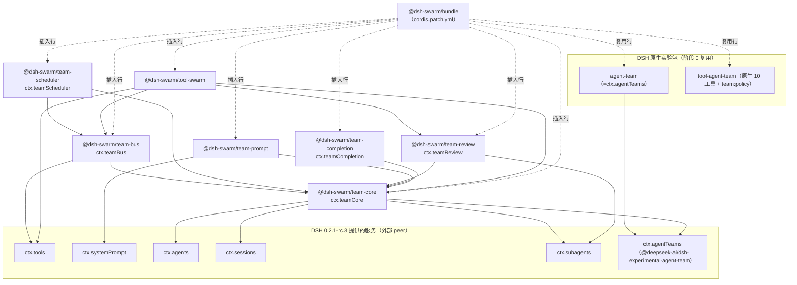

# dsh-swarm 包布局与发布顺序

> 配套：[`implementation-spec.md`](./implementation-spec.md)（实现规格）
> 产出人：migration-architect ｜ 任务：P3-spec
> 约定：`【事实】`= 来自 DSH 0.2.1-rc.3 / example-plugin / 手册；`【设计主张】`= 本规格建议。

---

## 1. 包名 / 路径 / 阶段

| 包名 | 路径 | cordis 插件名（row id） | 服务键 | 形态 | 阶段 |
|---|---|---|---|---|---|
| `@dsh-swarm/example-plugin` | `packages/example-plugin/` | `example-plugin` | — | 函数式 | 已有（基线） |
| `@dsh-swarm/team-core` | `packages/team-core/` | `team-core` | `ctx.teamCore` | Service | 0 |
| `@dsh-swarm/bundle` | `packages/bundle/` | （bundle，无 row） | — | bundle patch | 0 |
| `@dsh-swarm/team-bus` | `packages/team-bus/` | `team-bus` | `ctx.teamBus` | Service | 1 |
| `@dsh-swarm/team-scheduler` | `packages/team-scheduler/` | `team-scheduler` | `ctx.teamScheduler` | Service | 1 |
| `@dsh-swarm/team-review` | `packages/team-review/` | `team-review` | `ctx.teamReview` | Service | 1 |
| `@dsh-swarm/team-completion` | `packages/team-completion/` | `team-completion` | `ctx.teamCompletion` | Service | 1 |
| `@dsh-swarm/team-prompt` | `packages/team-prompt/` | `team-prompt` | （用 `ctx.systemPrompt`） | 函数式 | 1 |
| `@dsh-swarm/tool-swarm` | `packages/tool-swarm/` | `tool-swarm` | （用 `ctx.tools`） | 函数式 | 1 |

**【设计主张】命名规则**：项目名 `dsh-swarm`（用户明确要求，非 team）；原 `@dsh-team/*` 的 scope 一律替换为 `@dsh-swarm/*`；bundle 固定 `@dsh-swarm/bundle`。插件名与 row id 同名（对齐 example-plugin）。

**阶段 2+（登记，不在本布局实现）**：`@dsh-swarm/team-skills`、`team-memory`、`team-compaction`、`team-workspace`、`transport-*`、`channels`、`host-bridge`、Web UI。

---

## 2. 依赖图



**依赖分层（自底向上）**：
- **L0 外部 peer**：`@deepseek-ai/cordis`、`dsh-tools`、`dsh-system-prompt`、`dsh-agent`、`dsh-session`、`dsh-llm`（+ 可选实验包）。
- **L1 team-core**：唯一直接依赖 `ctx.agentTeams` 的包；对外只暴露 `ctx.teamCore`。
- **L2 能力插件**：`team-bus`（依赖 team-core）；`team-review`（依赖 team-core + subagents）；`team-completion`（依赖 team-core + sessions）；`team-prompt`（依赖 systemPrompt + team-core）。
- **L3 编排插件**：`team-scheduler`（依赖 team-core + team-bus）；`tool-swarm`（依赖 bus/review/core + tools）。
- **L4 组合**：`bundle` 依赖全部插件包 + 原生两包，仅含 patch。

**依赖方向唯一**：`bundle → 插件 → team-core → （agentTeams 可选 / sessions / subagents / agents）`。**禁止**插件之间反向依赖或循环依赖；**禁止**任何插件（除 `team-core`）直接 import 实验包类型。

**【事实·bundle 装配】** 激活顺序**不由行序决定**，由服务可用性（`inject`）驱动（plugin-dev-guide §3.2）——故 patch 中行序仅供阅读，真实拓扑由上图决定。

---

## 3. 发布顺序（阶段 0/1，本地 `workspace:~` 即可；发布时按此序）

> 【事实·plugin-dev-guide B8】发布前必须确保各包 peer 上的 `@deepseek-ai/dsh-*` 与 runtime 版本匹配，否则 profile 会跳过 bundle。

1. **`@dsh-swarm/team-core`**（被所有插件依赖，必须最先可解析）
2. `@dsh-swarm/team-prompt`、`@dsh-swarm/team-bus`、`@dsh-swarm/team-review`、`@dsh-swarm/team-completion`（互不依赖，可并行）
3. `@dsh-swarm/team-scheduler`、`@dsh-swarm/tool-swarm`（依赖 L2）
4. **`@dsh-swarm/bundle`**（依赖全部，最后）

阶段 0 只发布 1 与 4（外加依赖原生两包）。

---

## 4. 仓库目录（落地后）

```
dsh-swarm/
├── package.json · pnpm-workspace.yaml · tsconfig.base.json · eslint.config.mjs · .prettierrc.json   # 已存在
├── scripts/{env.sh,setup-env.sh,verify-load.mjs}                                                    # 已存在
├── docs/{env-setup.md,plugin-dev-guide.md,verification.md,implementation-spec.md,package-layout.md}
├── packages/
│   ├── example-plugin/                 # 已有（基线，勿动）
│   ├── team-core/{src/index.ts,tests/,tsconfig.json,package.json}          # 阶段 0
│   ├── bundle/{src/index.ts,cordis.patch.yml,package.json}                 # 阶段 0
│   ├── team-bus/ … team-scheduler/ … team-review/ … team-completion/
│   ├── team-prompt/ … tool-swarm/                                          # 阶段 1
└── .runtime/                           # 隔离环境（gitignore，勿提交）
```

**每包标准结构（对齐 example-plugin，【事实】）**：
```
packages/<pkg>/
├── src/index.ts          # 唯一入口（模块头 @module @dsh-swarm/<pkg>）
├── tests/<pkg>.spec.ts   # vitest（假 ctx）
├── tsconfig.json         # extends ../../tsconfig.base.json；rootDir src / outDir lib
└── package.json          # main lib/index.js · types lib/index.d.ts · scripts build/typecheck/test
```
**bundle 包额外**：`cordis.patch.yml` + `exports["./cordis.patch.yml"]` + `dsh.bundle.patch`。

---

## 5. 命名一致性检查表（实现时自检）

| 检查项 | 规则 |
|---|---|
| package name | `@dsh-swarm/<pkg>` |
| `export const name`（函数式） / `super(ctx,'<key>')`（Service） | 与 row id 同名 |
| `cordis.patch.yml` 的 row `id` | 与上同名 |
| `cordis.patch.yml` 的 row `name` | 等于 package name（`@dsh-swarm/<pkg>`） |
| 服务键 | `ctx.teamCore` / `ctx.teamBus` / `ctx.teamScheduler` / `ctx.teamReview` / `ctx.teamCompletion` |
| durable 事件前缀 | dsh-swarm 自有事件用 `swarm/*`；**不改**原生 `team/*` 的 `version`（现为 2） |

---

## 6. 待确认

- 【设计主张】`team-stale` 并入 `team-scheduler` 内部模块（不单列包）——若后续需要独立降级/复用，再拆为 `@dsh-swarm/team-stale`（包名已登记预留）。
- 【设计主张】`team-core` 的 `TeamCoreOwned` 后端是否实现，取决于 P3-spike；若实现，仍在 `team-core` 包内（不新增包）。
- 【事实】`@deepseek-ai/dsh-experimental-agent-team` / `-tool-agent-team` 为 experimental、无版本承诺；本布局把它们作为 `bundle` 的普通 dependency，但通过 `team-core` 端口隔离，未来可整体替换。

---

*（本文件由 migration-architect 产出；包清单/依赖/顺序为设计主张，DSH 装配契约属实。）*
