# dsh-swarm 包布局与发布顺序

> 配套：[`implementation-spec.md`](./implementation-spec.md)（阶段 0/1 规格）、[`implementation-spec-stage2.md`](./implementation-spec-stage2.md)（阶段 2 规格）
> 产出人：migration-architect ｜ 任务：P3-spec（阶段 0/1）→ **P6-spec-stage2（阶段 2 更新）**
> 约定：`【事实】`= 来自 DSH 0.2.1-rc.3 / example-plugin / 手册 / 已实现 9 包；`【设计主张】`= 本规格建议。

---

## 1. 包名 / 路径 / 阶段

| 包名 | 路径 | cordis 插件名（row id） | 服务键 | 形态 | 阶段 |
|---|---|---|---|---|---|
| `@dsh-swarm/example-plugin` | `packages/example-plugin/` | `example-plugin` | — | 函数式 | 已有（基线） |
| `@dsh-swarm/team-core-contract` | `packages/team-core-contract/` | （纯类型，无 row） | — | 纯类型 | 0 |
| `@dsh-swarm/team-core` | `packages/team-core/` | `team-core` | `ctx.teamCore` | Service | 0 |
| `@dsh-swarm/bundle` | `packages/bundle/` | （bundle，无 row） | — | bundle patch | 0 |
| `@dsh-swarm/team-bus` | `packages/team-bus/` | `team-bus` | `ctx.teamBus` | Service | 1 |
| `@dsh-swarm/team-scheduler` | `packages/team-scheduler/` | `team-scheduler` | `ctx.teamScheduler` | Service | 1 |
| `@dsh-swarm/team-review` | `packages/team-review/` | `team-review` | `ctx.teamReview` | Service | 1 |
| `@dsh-swarm/team-completion` | `packages/team-completion/` | `team-completion` | `ctx.teamCompletion` | Service | 1 |
| `@dsh-swarm/team-prompt` | `packages/team-prompt/` | `team-prompt` | （用 `ctx.systemPrompt`） | 函数式 | 1 |
| `@dsh-swarm/tool-swarm` | `packages/tool-swarm/` | `tool-swarm` | （用 `ctx.tools`） | 函数式 | 1 |
| **`@dsh-swarm/team-capability-contract`** | `packages/team-capability-contract/` | （纯类型，无 row） | — | 纯类型 | **2** |
| **`@dsh-swarm/team-workspace`** | `packages/team-workspace/` | `team-workspace` | `ctx.teamWorkspace` | Service | **2** |
| **`@dsh-swarm/team-skills`** | `packages/team-skills/` | `team-skills` | `ctx.teamSkills` | Service | **2** |
| **`@dsh-swarm/team-memory`** | `packages/team-memory/` | `team-memory` | `ctx.teamMemory` | Service | **2** |
| **`@dsh-swarm/team-compaction`** | `packages/team-compaction/` | `team-compaction` | `ctx.teamCompaction` | Service | **2** |

> **包数：9（阶段 0/1）→ 14（阶段 2 后）**。`team-core-contract` 与 `team-capability-contract` 均为**纯类型 SSOT 包**（零运行时实现）。
> **【事实·ADR-0001】** `team-core-contract` 是 `ctx.teamCore` 的唯一类型 SSOT；`team-bus`/`team-prompt`/`team-scheduler`/`team-review`/`team-completion`/`tool-swarm`/`team-core` **禁止** import 实现包，只从契约包取类型。
> **【设计主张·P6-spec-stage2 §1.1】** 阶段 2 新增独立契约包 `team-capability-contract`（承载 `ctx.teamWorkspace/teamSkills/teamMemory/teamCompaction` 四端口），**不塞进 `team-core-contract`**：二者是不同 cohort（协作内核层 vs 能力供给层）、不同冻结时点；独立成包同样满足 ADR-0001 的编译期边界，且 `team-core-contract` 保持冻结。

**【设计主张】命名规则**：项目名 `dsh-swarm`（用户明确要求，非 team）；scope 一律 `@dsh-swarm/*`；bundle 固定 `@dsh-swarm/bundle`。插件名与 row id 同名（对齐 example-plugin）。

**阶段 3+（登记，不在当前布局实现）**：`@dsh-swarm/transport-*`、`channels`、`host-bridge`、Web UI。

---

## 2. 依赖图

```mermaid
flowchart TB
  subgraph DSH["DSH 0.2.1-rc.3 提供的服务（外部 peer）"]
    TOOLS[ctx.tools]
    SP[ctx.systemPrompt]
    AG[ctx.agents]
    SESS[ctx.sessions]
    SUB[ctx.subagents]
    ATS["ctx.agentTeams（实验）"]
    FS["ctx.fs + fs/write-intent"]
    WD[ctx.workingDirectory]
    WT["ctx.worktrees（实验）"]
    SK[ctx.skills]
    ST[ctx.storage]
    CMP[ctx.compaction]
  end
  subgraph CONTRACTS["契约包（纯类型 SSOT）"]
    CC1["@dsh-swarm/team-core-contract<br/>ctx.teamCore 类型"]
    CC2["@dsh-swarm/team-capability-contract<br/>ctx.teamWorkspace/teamSkills/teamMemory/teamCompaction 类型"]
  end
  subgraph NATIVE["DSH 原生实验包（复用）"]
    NAT_TEAM["agent-team（=ctx.agentTeams）"]
    NAT_TOOL["tool-agent-team"]
  end
  CORE["team-core"]
  BUS["team-bus"]
  SCH["team-scheduler"]
  REV["team-review"]
  COMP["team-completion"]
  PROMPT["team-prompt"]
  TOOL["tool-swarm"]
  WS["team-workspace"]
  SKL["team-skills"]
  MEM["team-memory"]
  CMPC["team-compaction"]
  BUNDLE["@dsh-swarm/bundle<br/>（cordis.patch.yml）"]

  NAT_TEAM --> ATS
  CORE --> ATS
  CORE --> AG
  CORE --> SESS
  CORE --> SUB
  BUS --> CORE
  BUS --> TOOLS
  SCH --> CORE
  SCH --> BUS
  REV --> CORE
  REV --> SUB
  COMP --> CORE
  PROMPT --> SP
  PROMPT --> CORE
  TOOL --> BUS
  TOOL --> REV
  TOOL --> CORE
  TOOL --> TOOLS

  WS --> FS
  WS --> WD
  WS --> WT
  WS --> CORE
  SKL --> SK
  SKL --> AG
  SKL --> CORE
  MEM --> SP
  MEM --> ST
  MEM --> CORE
  CMPC --> CMP
  CMPC --> SP
  CMPC --> CORE

  PROMPT -.->|type-only| CC2
  TOOL -.->|type-only| CC2
  BUNDLE -.->|插入行| CORE
  BUNDLE -.->|插入行| BUS
  BUNDLE -.->|插入行| SCH
  BUNDLE -.->|插入行| REV
  BUNDLE -.->|插入行| COMP
  BUNDLE -.->|插入行| PROMPT
  BUNDLE -.->|插入行| TOOL
  BUNDLE -.->|插入行| WS
  BUNDLE -.->|插入行| SKL
  BUNDLE -.->|插入行| MEM
  BUNDLE -.->|插入行| CMPC
  BUNDLE -.->|复用行| NAT_TEAM
  BUNDLE -.->|复用行| NAT_TOOL
```



**依赖分层（自底向上）**：
- **L0 外部 peer**：`@deepseek-ai/cordis`、`dsh-tools`、`dsh-system-prompt`、`dsh-agent`、`dsh-session`、`dsh-llm` + 阶段 2 追加的 `dsh-fs`、`dsh-skills`、`dsh-storage`、`dsh-compaction`（+ 可选实验 `dsh-experimental-worktree`）。
- **L1 契约 + core**：`team-core-contract`（纯类型）、`team-capability-contract`（纯类型）、`team-core`（唯一直接依赖 `ctx.agentTeams` 的实现包）。
- **L2 协作插件（阶段 1）**：`team-bus`、`team-review`、`team-completion`、`team-prompt`。
- **L2' 能力供给插件（阶段 2）**：`team-workspace`、`team-skills`、`team-memory`、`team-compaction`。
- **L3 编排插件**：`team-scheduler`（core+bus）；`tool-swarm`（bus/review/core+阶段 2 四服务，可选）。
- **L4 组合**：`bundle` 依赖全部插件包 + 原生两包，仅含 patch。

**依赖方向唯一**：`bundle → 插件 → {team-core, 各自 seam}`；契约包被 type-only 依赖。**禁止**插件反向/循环依赖；**禁止**除 `team-core` 外任何包 import 实验包类型（`team-workspace` 与 `ctx.worktrees` 的交互也必须经**结构化本地接口**描述，不 import 实验包类型 —— 与 `team-core` 对 `ctx.agentTeams` 的做法一致）。

**【事实·bundle 装配】** 激活顺序**不由行序决定**，由服务可用性（`inject`）驱动（plugin-dev-guide §3.2）。

---

## 3. 发布顺序

> 【事实·plugin-dev-guide B8】发布前必须确保各包 peer 上的 `@deepseek-ai/dsh-*` 与 runtime 版本匹配，否则 profile 会跳过 bundle。

**阶段 0/1（已完成，远端 main = `2b63e6e`）**：
1. `team-core-contract` → 2. `team-core` → 3. `team-prompt`/`team-bus`/`team-review`/`team-completion` → 4. `team-scheduler`/`tool-swarm` → 5. `bundle`。

**阶段 2 追加顺序**【设计主张】：
6. **`team-capability-contract`**（被 4 个阶段 2 包 type-only 依赖，必须先可解析）
7. `team-workspace` / `team-skills` / `team-memory` / `team-compaction`（互不依赖，可并行）
8. **`bundle`**（追加 4 行后重新构建；依赖全部插件包）
9. （可选）`tool-swarm` 增量发布（新增阶段 2 工具）

---

## 4. 仓库目录（阶段 2 后）

```
dsh-swarm/
├── package.json · pnpm-workspace.yaml · tsconfig.base.json · eslint.config.mjs · .prettierrc.json   # 已存在
├── scripts/{env.sh,setup-env.sh,verify-load.mjs}                                                    # 已存在
├── docs/
│   ├── env-setup.md · plugin-dev-guide.md · verification.md
│   ├── implementation-spec.md · implementation-spec-stage2.md
│   ├── agent-team-spike.md · package-layout.md
│   └── adr/0001-team-core-contract-package.md
├── packages/
│   ├── example-plugin/                         # 基线
│   ├── team-core-contract/                     # 阶段 0（纯类型）
│   ├── team-core/ · bundle/                    # 阶段 0
│   ├── team-bus/ · team-scheduler/ · team-review/ · team-completion/ · team-prompt/ · tool-swarm/   # 阶段 1
│   └── team-capability-contract/               # 阶段 2（纯类型）
│       team-workspace/ · team-skills/ · team-memory/ · team-compaction/                              # 阶段 2
└── .runtime/                                   # 隔离环境（gitignore，勿提交）
```

**每包标准结构（对齐 example-plugin，【事实】）**：
```
packages/<pkg>/
├── src/index.ts          # 唯一入口（模块头 @module @dsh-swarm/<pkg>）
├── tests/<pkg>.spec.ts   # vitest（假 ctx）
├── tsconfig.json         # extends ../../tsconfig.base.json；rootDir src / outDir lib
└── package.json          # main lib/index.js · types lib/index.d.ts · scripts build/typecheck/test
```
**契约包**：`src/index.ts` 再导出各域子模块；运行时 `export {}`（零导出），测试用 `expectTypeOf` 冻结形状。
**bundle 包额外**：`cordis.patch.yml` + `exports["./cordis.patch.yml"]` + `dsh.bundle.patch`。

---

## 5. 命名一致性检查表（实现时自检）

| 检查项 | 规则 |
|---|---|
| package name | `@dsh-swarm/<pkg>` |
| `export const name`（函数式） / `super(ctx,'<key>')`（Service） | 与 row id 同名 |
| `cordis.patch.yml` 的 row `id` | 与上同名 |
| `cordis.patch.yml` 的 row `name` | 等于 package name（`@dsh-swarm/<pkg>`） |
| 服务键（阶段 0/1） | `ctx.teamCore` / `ctx.teamBus` / `ctx.teamScheduler` / `ctx.teamReview` / `ctx.teamCompletion` |
| 服务键（阶段 2） | `ctx.teamWorkspace` / `ctx.teamSkills` / `ctx.teamMemory` / `ctx.teamCompaction` |
| 契约包 | 只含类型；运行时零导出；`ctx.team*` 类型增强放对应契约包 |
| durable 事件前缀 | dsh-swarm 自有事件用 `swarm/*`（阶段 2 增 `swarm/workspace/*`、`swarm/skills/*`、`swarm/memory/*`、`swarm/compaction/*`）；**不改**原生 `team/*` 的 `version`（现为 2） |
| 工具 schema | `output` 必填；`required: true` 逐属性；可选参数省略 `required`；只用白名单键（手册 §7） |

---

## 6. 待确认

- 【设计主张】`team-stale` 并入 `team-scheduler` 内部模块（已落地，不单列包）。
- 【设计主张】`team-core` 的 `TeamCoreOwned` 后端保持不实现（spike 判定 native 可用）。
- 【事实】`@deepseek-ai/dsh-experimental-agent-team` / `-tool-agent-team` / **`dsh-experimental-worktree`** 均为 experimental、无版本承诺；经端口隔离（`team-core` 与 `team-workspace` 各自的结构化 seam 接口），未来可整体替换。
- 【设计主张·阶段 2 §1.1】`team-capability-contract` 单包承载四端口；若阶段 3 契约显著增多，再评估按域拆分。
- 【待确认·阶段 2 §9】`fs/write-intent` 拒绝语义、`ctx.skills` per-agent scope API、`ctx.worktrees`/`ctx.workingDirectory` 可用性、`ctx.storage` forms —— 实现期对 0.2.1-rc.3 源码核验并回写手册。

---

*（本文件由 migration-architect 产出；阶段 0/1 部分源自 P3-spec，阶段 2 部分由 P6-spec-stage2 更新。包清单/依赖/顺序为设计主张，DSH 装配契约属实。）*
